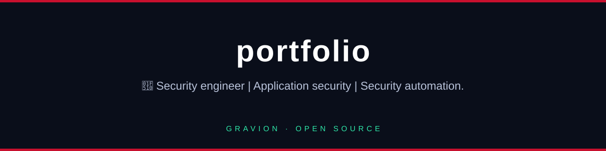

# Portfolio — Priyanshu Kumar Thakur

 

**🔐 Security engineer | Application security | Security automation.**

**Live site:** https://gravion-ux.github.io/portfolio

🔗 [LinkedIn](https://www.linkedin.com/in/priyanshukumarthakur) ·
🔗 [Fiverr](https://www.fiverr.com/ig_priyanshu) ·
🔗 [GitHub](https://github.com/gravion-ux) ·
🔗 [Sponsor](https://github.com/sponsors/gravion-ux)

---

## About

I am a security engineer focused on web and API security, vulnerability assessment,
and authorized penetration testing. My day-to-day work centers on **OWASP Top 10**
and **OWASP API Top 10**: finding authorization flaws (BOLA and IDOR),
authentication and session-handling weaknesses, injection, and unsafe business logic,
then writing reports that engineers can act on.

Alongside that, I build and maintain **open-source tooling** — 60 published
projects, all of them MIT licensed — covering vulnerability triage, detection-rule
conformance, engagement evidence, and auditing for the AI systems that ship beside
modern applications. I contribute bug fixes upstream to the projects I use.

---

## The numbers, and where they come from

| Claim | Value | Source |
| --- | --- | --- |
| Authored open-source projects | 60 | The 64 public repositories minus this profile repository, this website repository, and two forks of other maintainers' projects |
| Test cases across 60 projects | 4,866 collected, 4,854 passing, 12 skipped, 0 failing (22–27 Nov sweep) | Each repository's own suite, run on a fresh clone between 2026-11-22 and 2026-11-27; all 60 repositories ship a suite |
| The five flagship builds | 945 + 90 + 46 + 58 + 38 = 1,177 tests | `gravion-ai`, `wp-cve-hunter`, `llm-redteam-kit`, `mcp-shield`, `jwt-auditor` |
| MIT licensed | 60 of 60 | GitHub license detection on every project repository, re-checked 2026-11-27; `security-research` and `gravion-bot` received MIT licences on 2026-11-27 |
| Repositories with a CI workflow | 60 of 60 | The `.github/workflows` directory of each repository |
| Repositories whose own test suite runs in CI | 60 of 60 | Every workflow file audited on 2026-11-27 — each runs that repository's own suite on `push` and `pull_request` |
| Node tools with zero runtime dependencies | 19 of 21 | `package.json` of each repository |
| Python tools with zero runtime dependencies | 29 of 33 | `pyproject.toml` and `requirements.txt` of each repository |
Nothing on this site is estimated. The inventory is regenerated from the live GitHub
API by `tools/refresh_projects.py`, and the test counts come from
`tools/verified-tests.json`, which records the exact command used for each count.

---

## Projects

### Red-team and detection engineering

| Project | What it does | Tests |
| --- | --- | --- |
| [iamosiac](https://github.com/gravion-ux/iamosiac) | Offline cloud-IAM policy review and permission-relationship visualization data, with least-privilege remediation hints. | 61 tests |
| [wp-cve-hunter](https://github.com/gravion-ux/wp-cve-hunter) | Match WordPress plugin and theme versions against known CVEs — a defensive, authorised-testing CLI for site owners and bug bounty researchers. | 90 tests |
| [llm-redteam-kit](https://github.com/gravion-ux/llm-redteam-kit) | Authorized LLM red-teaming evaluation toolkit: OWASP LLM Top 10 probe packs, heuristic scoring, CI regression gates. | 46 tests |
| [mcp-shield](https://github.com/gravion-ux/mcp-shield) | Defensive security auditor for MCP server configurations and tool definitions. | 58 tests |
| [jwt-auditor](https://github.com/gravion-ux/jwt-auditor) | Defensive security auditor for JSON Web Tokens: alg=none, weak HMAC secrets, embedded keys, kid injection, lifetime and claim hygiene. | 38 tests |
| [rulebench](https://github.com/gravion-ux/rulebench) | Sigma rule conformance harness: run rules against events, lint them, and measure coverage against the MITRE knowledge base. | 198 tests |
| [fixqueue](https://github.com/gravion-ux/fixqueue) | Merge SARIF, Trivy, Grype and OSV scanner output into one deduplicated, EPSS and KEV prioritized fix queue. | 157 tests |
| [opsledger](https://github.com/gravion-ux/opsledger) | Tamper-evident evidence ledger for red-team engagements: hash-chained events and a signed manifest. | 137 tests |
| [secret-sniper](https://github.com/gravion-ux/secret-sniper) | Leaked credential detection with live verification. | 69 checks |
| [apishield](https://github.com/gravion-ux/apishield) | Zero-dependency API security gateway: a monitor and enforce reverse proxy that catches BOLA/IDOR ownership flaws, JWT weaknesses and response data exposure before they ship. | 59 tests |
| [violet-trace](https://github.com/gravion-ux/violet-trace) | A safe purple-team validation harness for defensive telemetry and detection-rule tests. | 34 tests |
| [accessweave](https://github.com/gravion-ux/accessweave) | Offline identity-relationship and directory-permission review from explicitly exported inventory data. | 33 tests |
| [cipherbench](https://github.com/gravion-ux/cipherbench) | A benchmark and interoperability test harness specification for vetted post-quantum cryptographic providers. | 29 tests |
| [subdangler](https://github.com/gravion-ux/subdangler) | Dangling DNS and subdomain takeover risk checker: resolves CNAME records over DNS-over-HTTPS, matches them against takeover-prone services and reports the ones that look unclaimed. Authorised use only. | 28 tests |
| [gravion-hunter](https://github.com/gravion-ux/gravion-hunter) | Autonomous bug bounty agent framework — scope-locked hunting, a hard 7-question validation gate, dedupe-in-the-loop, and a validity brake on autopilot submission. | 26 tests |
| [quanta-sentry](https://github.com/gravion-ux/quanta-sentry) | Cryptographic inventory and post-quantum migration-readiness reporting from source and configuration evidence. | 26 tests |
| [fuzzharbor](https://github.com/gravion-ux/fuzzharbor) | A reproducible local fuzzing campaign manager and crash triage toolkit. | 21 tests |
| [universal-hacker-kit](https://github.com/gravion-ux/universal-hacker-kit) | A Claude Code command kit for bug bounty hunting: write, triage, gotchas and dedupe commands for drafting and validating reports before submission (free edition). | 13 tests |
| [redteamlabs](https://github.com/gravion-ux/redteamlabs) | Three local WordPress labs for authorised plugin testing: a CLI and a web dashboard that start, stop and health-check three lab instances on fixed ports, with setup scripts and systemd units for a repeatable rig. Binds to localhost only and ships no credentials. | 10 tests |
| [pe-import-lens](https://github.com/gravion-ux/pe-import-lens) | Dependency-free Windows PE import-table triage: lists every imported function and flags the imports tied to process injection, process hollowing, keylogging and anti-analysis checks. The target file is only parsed, never executed. | 7 tests |
| [memsafety-lab](https://github.com/gravion-ux/memsafety-lab) | Educational memory-safety lab: scans C source for the unsafe functions behind classic buffer overflows and prints the safe replacement for every hit as a fix checklist. | 5 tests |
| [winapi-surface-auditor](https://github.com/gravion-ux/winapi-surface-auditor) | Defensive code review for C and C++ source: scans Windows API usage patterns tied to cross-process injection, input interception and legacy process creation, and explains the safer alternative for each hit. It ships no exploit code. | 5 tests |
| [winapi-sentinel](https://github.com/gravion-ux/winapi-sentinel) | Static source-code triage for risky Windows API usage patterns, flagging single sensitive calls and multi-call injection chains with file and line evidence for every finding. | 4 tests |

### AI and agent security

| Project | What it does | Tests |
| --- | --- | --- |
| [gravion-ai](https://github.com/gravion-ux/gravion-ai) | Gravion AI: a modular AI platform framework — many AI types, four tiers, one module system, with a cryptographic licensing and entitlement layer for commercial deployments. | 945 tests |
| [preference-data-doctor](https://github.com/gravion-ux/preference-data-doctor) | Diagnoses and repairs preference datasets: duplicates, contradictions, class imbalance, format drift, leaked secrets. | 147 tests |
| [gravion-harness](https://github.com/gravion-ux/gravion-harness) | A scoped, auditable security-testing harness with a hash-chained audit log. | 142 tests |
| [skill-supply-chain-auditor](https://github.com/gravion-ux/skill-supply-chain-auditor) | Audits agent skill packages for prompt injection, unsafe shell, obfuscated payloads, embedded secrets, unpinned dependencies. | 125 tests |
| [memorytrust](https://github.com/gravion-ux/memorytrust) | Audits an agent memory store for unverified, stale, contradictory and sensitive content and scores how much can be trusted. | 112 tests |
| [local-slm-eval-kit](https://github.com/gravion-ux/local-slm-eval-kit) | Evaluates a local model against a fixed task suite with redaction, timeouts and diffable reports. | 108 tests |
| [gravion-pets](https://github.com/gravion-ux/gravion-pets) | AI pet companion framework — 46 original pets across 10 categories (gods and devils included), personalities, moods, bonds and an actions and movements system. | 76 tests |
| [context-bridge](https://github.com/gravion-ux/context-bridge) | A VS Code extension that writes privacy-conscious Markdown handoffs, with secret redaction built in. | 66 tests |
| [agent-skills](https://github.com/gravion-ux/agent-skills) | A 1200-skill agent skill library with a deterministic master router that selects the right skill for any task. | 48 tests |
| [gravion-trainner](https://github.com/gravion-ux/gravion-trainner) | Model quality evaluation starter for OpenAI-compatible chat-completions endpoints. | 45 tests |
| [llm-security-bot](https://github.com/gravion-ux/llm-security-bot) | Pattern-based static analysis for code, configs, log lines and LLM input — deterministic, so the output is a triage list, not proof of exploitability. | 20 tests |
| [ai-model-fingerprint](https://github.com/gravion-ux/ai-model-fingerprint) | Defensive checker for AI model files: detects the container format, computes SHA-256 fingerprints, lists the URLs embedded in the file header and verifies model files against a hash manifest. It never executes model code. | 5 tests |

### Assessment, automation and platform

| Project | What it does | Tests |
| --- | --- | --- |
| [Her--Him](https://github.com/gravion-ux/Her--Him) | Two complete AI-companion personality catalogues with a deterministic, explainable affect engine and mood-driven multilingual voice. | 438 tests |
| [TRISHUL](https://github.com/gravion-ux/TRISHUL) | Authorized-scope, AI-powered security testing platform with real tool integration behind scope gates and an AI policy boundary. | 335 tests |
| [aegis](https://github.com/gravion-ux/aegis) | Multi-agent system core: task lifecycle, persistent memory, provider abstraction, default-deny tool registry, budgets and recovery. | 315 tests |
| [vulndesk](https://github.com/gravion-ux/vulndesk) | Multi-tenant vulnerability-management and triage platform: tenant-isolated workspaces, RBAC, a real CVSS 3.1 scoring engine, hash-based dedupe and exportable reports. | 61 tests |
| [localshare](https://github.com/gravion-ux/localshare) | Shares a local development server through Cloudflare tunnels, with loopback-only origins. | 51 tests |
| [privacyflow](https://github.com/gravion-ux/privacyflow) | Validates authorized WireGuard profiles and plans safe VPN rotation workflows. | 50 tests |
| [rasgulla-ai](https://github.com/gravion-ux/rasgulla-ai) | A local-first AI-assisted security research workbench for code understanding and safe test generation. | 50 tests |
| [gravion-hacker](https://github.com/gravion-ux/gravion-hacker) | Offline-first authorized security assessment suite: scope-gated, read-only checks over headers, cookies, CORS policy, TLS and DNS snapshots, JWT structure, dependency manifests and local source, with a CLI, a web UI and report-ready evidence. | 45 tests |
| [webapp-security-toolkit](https://github.com/gravion-ux/webapp-security-toolkit) | Authorized-only web and API security assessment toolkit: header analysis, TLS posture, scope enforcement, structured findings. | 44 tests |
| [agent-browser](https://github.com/gravion-ux/agent-browser) | Visible Playwright browser starter with an explicit domain allow-list and explicit stop conditions. | 43 tests |
| [openapi-diff](https://github.com/gravion-ux/openapi-diff) | OpenAPI 3.x breaking-change differ with CI-friendly exit codes: resolves local references so schemas are compared by effective shape, then classifies every change as breaking, non-breaking or informational with a location and a reason. | 38 tests |
| [cookie-audit](https://github.com/gravion-ux/cookie-audit) | Pure Python cookie security analyzer: audits Set-Cookie headers for missing or weak security attributes, taking input from a file, a URL or standard input, with text or JSON reports and a severity threshold for CI. | 34 tests |
| [sri-guard](https://github.com/gravion-ux/sri-guard) | Subresource Integrity checker for HTML pages: finds external scripts and stylesheets whose integrity metadata is missing, malformed or does not match the served content, and reports the missing crossorigin attribute that stops the browser enforcing it. | 32 tests |
| [security-automation-scripts](https://github.com/gravion-ux/security-automation-scripts) | Small Node.js and Bash utilities: header analysis, TLS configuration check, log parsing helpers. | 22 tests |
| [web-security-labs](https://github.com/gravion-ux/web-security-labs) | Four OWASP-style labs (IDOR, XSS, broken-auth, logic-flaw), each with a vulnerable and a secure variant, loopback-only by design. | 22 tests |
| [api-security-testing](https://github.com/gravion-ux/api-security-testing) | Read-only BOLA and cross-tenant detector with a rate-limit probe, backed by a local mock API for reproducible demos. | 19 tests |
| [osint-footprint-checker](https://github.com/gravion-ux/osint-footprint-checker) | Scores the public footprint of an asset you own from a JSON snapshot: security.txt, security headers, SPF and DMARC, dangling CNAMEs and TLS posture, with the fix for every finding. Offline and snapshot-based. | 5 tests |

### Upstream contribution and other

| Project | What it does | Tests |
| --- | --- | --- |
| [catalog-forge](https://github.com/gravion-ux/catalog-forge) | Crawls a shop catalog and serves it as a storefront. | 156 tests |
| [expensemate](https://github.com/gravion-ux/expensemate) | ExpenseMate — React Native (Expo) expense tracker in TypeScript: categories, monthly summaries, breakdown charts, AsyncStorage persistence, multi-currency, dark theme. | 32 tests |
| [chatsphere](https://github.com/gravion-ux/chatsphere) | ChatSphere — real-time chat app (direct and group) with Socket.io and MongoDB: JWT-authenticated sockets, presence, typing indicators, unread counts; React frontend. | 31 tests |
| [taskforge](https://github.com/gravion-ux/taskforge) | TaskForge — full-stack team task manager (MERN): JWT auth, role-based access, projects, kanban boards with drag-and-drop, tasks, comments. | 17 tests |
| [security-research](https://github.com/gravion-ux/security-research) | Responsible-disclosure write-ups from my WordPress plugin security research — concept-level, sanitised, no exploit payloads. | 14 tests |
| [gravion-bot](https://github.com/gravion-ux/gravion-bot) | Terminal-first bot project with a separate web command deck: a TypeScript API server for bot sessions, commands and files, plus a small Python web shell that exposes help, status and pet commands in the browser. | 8 tests |
| [vocals](https://github.com/gravion-ux/vocals) | Browser voice and song studio: record or clone a voice, generate a procedural beat and mix and master a WAV export, with an optional bring-your-own AI voice endpoint that keeps the key in the browser. | 7 tests |
| [xerj-ipv6-rate-limit-fix](https://github.com/gravion-ux/xerj-ipv6-rate-limit-fix) | A contribution to xerj-org/xerj fixing the Corpus Hub rate limiter to bucket compressed IPv6 addresses by their /64. Merged upstream as xerj-org/xerj#2872 on 2026-11-17. | 4 tests |
---

## Services

Starting prices are published so you know the floor before you enquire. Scope is
confirmed in writing before any testing begins.

### 1. Web and API Security Assessment — from $500

An agreed list of targets. OWASP Top 10 and OWASP API Top 10 coverage with emphasis
on authorization and cross-tenant flaws, broken authentication and session handling,
injection, and rate limiting. Five business days. Deliverable is a findings report
with impact, reproduction steps and remediation guidance per finding, plus a retest of
critical findings. No testing outside the agreed scope.

### 2. Secure Code Review and Threat Modelling — from $300

Up to two pull requests or one service. Focus on access control, session handling,
input validation and injection paths, with a short threat model of the changed
surface. Three business days. Deliverable is inline findings with severity and
concrete fix suggestions, plus a written threat-model summary.

### 3. Security Automation Build — from $800

One small CI-friendly tool for your stack: scanner triage, a dependency gate, log
normalization, or detection-rule linting. Built as a repository with a test suite, a
CI pipeline and documentation, delivered with a working demo. Two to three weeks.

**Also quoted on scope:** detection-rule review and coverage analysis, cloud IAM and
permission review, and post-quantum migration-readiness inventory.

📬 [Enquire on Fiverr](https://www.fiverr.com/ig_priyanshu) or
[LinkedIn](https://www.linkedin.com/in/priyanshukumarthakur).

---

## Support the open-source work

Sponsorship pays for the parts nobody sees: issue triage, CI maintenance, dependency
review of my own tools, and the next release. Fourteen tiers are published on GitHub
Sponsors — eight monthly from $5, and six one-time from $25.

🔗 [Sponsor on GitHub](https://github.com/sponsors/gravion-ux)

The tools stay free and free of telemetry whether or not anyone sponsors them.
All 60 published projects carry the MIT licence.

---

## How I work

1. Read the code path first, before running tools.
2. Reproduce the bug with the smallest possible proof.
3. Quantify the impact in the business terms the engineer cares about.
4. Write the fix as a code suggestion, not just an observation.
5. Measure before and after, and quote only the numbers a command produced.

---

## Repository layout

| Path | What it is |
| --- | --- |
| `site/` | The static website served by GitHub Pages |
| `site/assets/projects.json` | Generated project inventory, built from the live GitHub API |
| `site/support.html` | The sponsorship page: the tier ladder, what each tier includes, and where a name gets placed |
| `tools/refresh_projects.py` | Regenerates the inventory. Run it whenever stars or descriptions change. |
| `tools/sync_project_tables.py` | Regenerates the project tables in this README from the inventory. |
| `tools/verified-tests.json` | Measured test counts, with the command used for each one |
| `docs/sponsors-setup.md` | The GitHub Sponsors content pack: bio, introduction, tiers and signup steps |
| `docs/launch-checklist.md` | The distribution checklist for launching the profile |
| `resume.md` | The short resume version |

## Licence

MIT. See [LICENSE](LICENSE).

## Games

Free HTML5 games on itch.io: [Neon Reflex Arena](https://gravion-ux.itch.io/neon-reflex-arena) · [Mind Maze](https://gravion-ux.itch.io/mind-maze) · [Gravity Orbit](https://gravion-ux.itch.io/gravity-orbit) · [Color Cascade](https://gravion-ux.itch.io/color-cascade) · [Shield Breaker](https://gravion-ux.itch.io/shield-breaker) · [Rhythm Runes](https://gravion-ux.itch.io/rhythm-runes)

